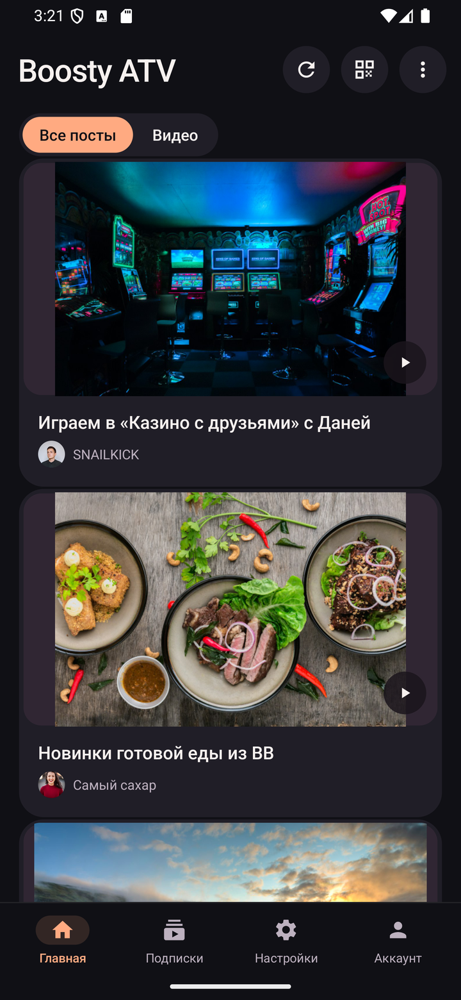
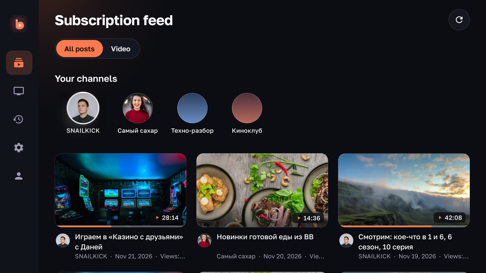

# Boosty ATV

[](https://github.com/cergo666/BoostyATV/releases/latest)
[](https://github.com/cergo666/BoostyATV/releases)
[](https://github.com/cergo666/BoostyATV/stargazers)
[](https://github.com/cergo666/BoostyATV/actions/workflows/android.yml)
[](https://github.com/cergo666/BoostyATV/releases/latest)

**[Сайт](https://cergo666.github.io/BoostyATV/)** · **[Скачать APK](https://github.com/cergo666/BoostyATV/releases/latest/download/BoostyATV.apk)** · [История изменений](CHANGELOG.md)

Неофициальный клиент Boosty для телефона и Android TV. Один APK для Android 8.0 и новее.

## Возможности

- Лента подписок с автоматической подгрузкой, полками «Ваши каналы» и «Продолжить просмотр» и отдельным режимом «Видео». На телефоне разделы переключаются нижней навигацией, лента обновляется свайпом вниз; на Android TV слева доступна сворачиваемая панель навигации (Navigation Rail), безрамочные 16:9 карточки со свечением в фокусе, сетка каналов и карточная история просмотра. Внутри канала есть поиск видео по названию и фильтр по тегам.
- Встроенный плеер с собственным HUD и выдвижной боковой панелью настроек. В ней доступны качество, скорость, аудиодорожки, субтитры, размер кадра, точная перемотка (`−10 с / +10 с` и переход ко времени) и статистика потоков. Поддерживаются HLS, DASH и MP4. Воспроизведение продолжается в фоне, управление доступно из медиа-уведомления.
- Новая тёмная и OLED-тема с чёрным фоном и динамическим ambient-свечением из обложек. Переключатель в настройках применяет OLED-тему мгновенно без перезапуска экрана.
- Современный интерфейс на Kotlin и Jetpack Compose со шрифтом Golos Text, скелетонами загрузки и едиными тёмными диалогами и боковыми панелями.
- Сохранение позиции просмотра на устройстве и синхронизация с Boosty. На карточках видео видны длительность и прогресс.
- Внешние плееры VLC, MX Player, ViMu и Just+ Player. Приложение передаёт сохранённую позицию и сохраняет новую, если плеер возвращает её.
- Комментарии открываются под видео (на ТВ — в отдельной боковой колонке), ответы раскрываются на месте. Реакции на публикации и комментарии можно ставить, менять и убирать.

## Установка и обновления

Скачайте APK из последнего релиза и откройте его на телефоне или Android TV. Если у вас стоит одна из тестовых сборок 0.x, удалите её перед установкой 1.0.0. Android попросит войти в Boosty заново после удаления.

Приложение проверяет обновления в фоне при запуске. При выходе новой версии оно покажет список изменений и предложит скачать APK. Проверку также можно запустить вручную через **⋯ → О программе → Проверить обновления**. Установку подтверждает Android.

## Скриншоты





## Вход и подключение ТВ

- На Android TV при запуске сразу открывается QR-код быстрого входа; при необходимости можно переключиться на ввод по номеру телефона.
- Введите номер, привязанный к аккаунту Boosty. Страну можно выбрать по флагу или вставить полный номер с `+`. Код приходит по каналу, который выберет Boosty.
- На телефоне доступен вход через ВК на странице Boosty. Если VK ID покажет CAPTCHA, пройдите её там же. Google требует системный браузер. Для аккаунта Google с привязанным номером доступен вход по номеру. [Политики Google OAuth](https://developers.google.com/identity/protocols/oauth2/policies#secure-browsers)
- Чтобы передать действующий вход с телефона на ТВ, подключите оба устройства к одной локальной сети IPv4. После входа на телефоне нажмите **«QR»** в ленте (или «Подключить ТВ» в настройках), отсканируйте QR-код с экрана телевизора и выберите **«Передать текущий вход»**. После истечения токена доступа отсканируйте новый QR-код или войдите на ТВ по номеру для отдельной сессии.

## Архитектура

`MainActivity.kt` управляет lifecycle, маршрутизацией (`AppRoute`), фоновой загрузкой и темой. UI построен на Jetpack Compose, а сетевое и системное ядро остаётся в лёгких Java-модулях:

- `BoostyTheme.kt`, `BoostyComponents.kt`, `AppShellCompose.kt` — цветовая палитра (тёмная / OLED), шрифт Golos Text, общие компоненты, боковые панели/диалоги и оболочка навигации (сворачиваемый Navigation Rail на ТВ / нижняя панель на телефоне).
- `FeedScreenCompose.kt`, `AuthorsScreenCompose.kt`, `HistoryScreenCompose.kt` — лента с полками «Ваши каналы» и «Продолжить просмотр», пагинацией и фильтрами; сетка каналов и карточная история.
- `PostScreenCompose.kt` — экран публикации с фоновым бэкдропом, комментариями и пикером реакций.
- `PlayerScreenCompose.kt` — контроллер Media3 против `PlaybackService`, кастомный HUD и выдвижное меню настроек плеера.
- `LoginScreenCompose.kt` — экран QR-сопряжения на ТВ, вход по номеру телефона, выбор страны и обёртка над `BoostyWebLogin`.
- `SettingsScreenCompose.kt`, `AccountScreenCompose.kt`, `AboutScreenCompose.kt`, `UpdateDialogsCompose.kt` — настройки, профиль, экран «О программе» и диалоги обновлений.
- `BoostyApi`, `SessionStore`, `WatchHistory`, `TvPairing`, `PlaybackService`, `Artwork`, `UpdateController`, `Post`, `Reactions`, `FeedFilter`, `TimeFormat`, `AppExecutors` — API, кэш обложек и ambient-цветов, локальное хранилище, обновления и протокол сопряжения.

## Сборка

Проверено с JDK 21, Android SDK Platform 37 и build-tools 36.0.0. Укажите путь к SDK в `ANDROID_HOME` или `local.properties`.

```powershell
.\gradlew.bat :app:testDebugUnitTest :app:assembleDebug :app:lintDebug --parallel
```

Unit-тесты (JVM) проверяют парсинг публикаций, релизов GitHub, реакций, номеров телефонов, качества видео и истории просмотра. Тестовый APK появится в `app/build/outputs/apk/debug/app-debug.apk`. Он устанавливается рядом с релизом как **Boosty ATV Test**. Сессия и настройки хранятся отдельно. Обновления GitHub относятся к релизной версии. Для установки на подключённое устройство выполните `adb install -r app/build/outputs/apk/debug/app-debug.apk`.

```powershell
.\gradlew.bat :app:connectedDebugAndroidTest
```

Инструментальные тесты запускаются в CI на эмуляторе (`.github/workflows/instrumented.yml`).

### Релизная сборка

Релиз собирается с R8 и сжатием ресурсов. Подпись необязательна: без ключа получается `app-release-unsigned.apk`.

```powershell
.\gradlew.bat :app:assembleRelease
```

Чтобы собрать подписанный APK, создайте `keystore.properties` в корне проекта (файл в `.gitignore`):

```properties
storeFile=release.jks
storePassword=...
keyAlias=...
keyPassword=...
```

Те же значения можно передать переменными окружения `BOOSTY_KEYSTORE`, `BOOSTY_KEYSTORE_PASSWORD`, `BOOSTY_KEY_ALIAS` и `BOOSTY_KEY_PASSWORD`. Версию можно переопределить без правки `build.gradle`:

```powershell
.\gradlew.bat :app:assembleRelease -PversionCode=2000000 -PversionName=2.0.0
```

Пуш тега `v2.0.0` запускает [workflow релиза](.github/workflows/release.yml): он считает `versionCode` как `major * 1 000 000 + minor * 1 000 + patch` (minor и patch — до 999), собирает подписанный APK из секретов и публикует GitHub-релиз.

В качестве референсов использованы [BoostBuddy](https://github.com/slartus/BoostBuddy), [BoostyVP](https://github.com/rico-x/BoostyVP) и [boosty-tv-app](https://github.com/ARDcode/boosty-tv-app).


## Лицензия и происхождение

Проект распространяется по лицензии MIT (см. `LICENSE`). Boosty ATV — неофициальный клиент, не связанный с Boosty.

Проекты BoostBuddy, BoostyVP и boosty-tv-app указаны как поведенческие и API-референсы; их исходный код в этот репозиторий не включён. Если вы добавляете код из проекта с другой лицензией, убедитесь, что условия совместимы, и обновите `NOTICE` и `LICENSE`. Подробнее — в `NOTICE` и `CONTRIBUTING.md`.

## Языки

По умолчанию интерфейс английский, русский перевод лежит в `res/values-ru`. На Android 13+ язык можно выбрать в системных настройках приложения; список языков задан в `res/xml/locales_config.xml`.

## Автор

[Sergey Molchanov (cergo666)](https://github.com/cergo666)

## История звёзд

[](https://star-history.com/#cergo666/BoostyATV&Date)
