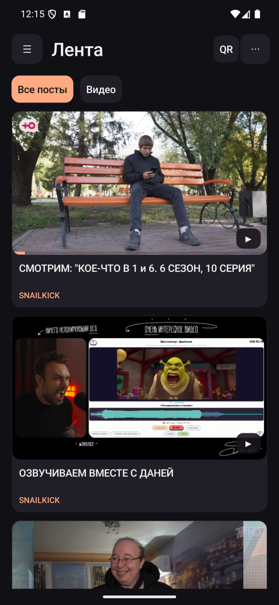
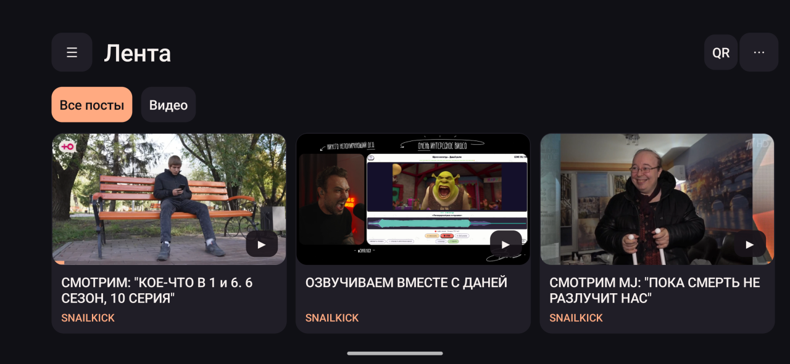

# Boosty ATV

[](https://github.com/cergo666/BoostyATV/releases/latest)
[](https://github.com/cergo666/BoostyATV/releases)
[](https://github.com/cergo666/BoostyATV/stargazers)
[](https://github.com/cergo666/BoostyATV/actions/workflows/android.yml)
[](https://github.com/cergo666/BoostyATV/releases/latest)

**[Скачать APK](https://github.com/cergo666/BoostyATV/releases/latest/download/BoostyATV.apk)** · [История изменений](CHANGELOG.md)

Неофициальный клиент Boosty для телефона и Android TV. Один APK для Android 8.0 и новее.

## Возможности

- Лента подписок с автоматической подгрузкой и отдельным режимом «Видео». На телефоне подписки открываются кнопкой ☰ слева, обновить ленту можно кнопкой ⟳. Внутри канала есть поиск видео по названию и фильтр по тегам.
- Встроенный плеер с нижней шестерёнкой. В ней доступны качество, скорость, аудиодорожки, субтитры, размер кадра, точная перемотка и статистика потоков. Поддерживаются HLS, DASH и MP4. Воспроизведение продолжается в фоне, управление доступно из медиа-уведомления.
- Тёмная и OLED-тема с чёрным фоном. Переключатель доступен в настройках приложения.
- Современный интерфейс: иконки в настройках, карточки с подзаголовками и нижняя навигация на телефоне.
- Сохранение позиции просмотра на устройстве и синхронизация с Boosty. На карточках видео виден прогресс.
- Внешние плееры VLC, MX Player, ViMu и Just+ Player. Приложение передаёт сохранённую позицию и сохраняет новую, если плеер возвращает её.
- Комментарии открываются под видео. Ответы раскрываются на месте. Реакции на публикации и комментарии можно ставить, менять и убирать.

## Установка и обновления

Скачайте APK из последнего релиза и откройте его на телефоне или Android TV. Если у вас стоит одна из тестовых сборок 0.x, удалите её перед установкой 1.0.0. Android попросит войти в Boosty заново после удаления.

Приложение проверяет обновления в фоне при запуске. При выходе новой версии оно покажет список изменений и предложит скачать APK. Проверку также можно запустить вручную через **⋯ → О программе → Проверить обновления**. Установку подтверждает Android.

## Скриншоты





## Вход и подключение ТВ

- Введите номер, привязанный к аккаунту Boosty. Страну можно выбрать по флагу или вставить полный номер с `+`. Код приходит по каналу, который выберет Boosty.
- На телефоне доступен вход через ВК на странице Boosty. Если VK ID покажет CAPTCHA, пройдите её там же. Google требует системный браузер. Для аккаунта Google с привязанным номером доступен вход по номеру. [Политики Google OAuth](https://developers.google.com/identity/protocols/oauth2/policies#secure-browsers)
- Чтобы передать действующий вход, подключите телефон и ТВ к одной локальной сети IPv4. На ТВ нажмите **«Войти с телефона»**. После входа на телефоне нажмите **«QR»** в ленте, отсканируйте код встроенной камерой и выберите **«Передать текущий вход»**. После истечения токена доступа отсканируйте новый QR-код или войдите на ТВ по номеру для отдельной сессии.

## Архитектура

`MainActivity` содержит только lifecycle, навигацию и общий «host» для экранов. Интерфейс разложен по отдельным классам:

- `FeedScreen` — лента, фильтры, пагинация и переиспользуемые карточки.
- `PostScreen` — публикация, комментарии и реакции.
- `PlayerScreen` — встроенный ExoPlayer, дорожки, статистика и внешние плееры; воспроизведение живёт в `PlaybackService`.
- `LoginScreen` — вход по номеру и WebView-логин; выбор страны — `CountryPicker`, QR-сопряжение с ТВ — `PairFlow`.
- `Navigator` — стек экранов с лимитом глубины; «О программе» и меню аккаунта — `AboutScreen` и `AccountMenu`.
- `AuthorsScreen` — подписки.
- `SettingsScreen` — настройки, тема и качество.
- `UpdateController` — проверка обновлений, SHA-256 и установка APK.
- `Ui`, `TimeFormat`, `FeedFilter`, `Artwork`, `AppExecutors` — общие помощники; `BoostyApi`, `SessionStore`, `WatchHistory`, `TvPairing` — данные и протокол.

## Сборка

Проверено с JDK 21, Android SDK Platform 37 и build-tools 36.0.0. Укажите путь к SDK в `ANDROID_HOME` или `local.properties`.

```powershell
.\gradlew.bat :app:testDebugUnitTest :app:assembleDebug :app:lintDebug --parallel
```

Unit-тесты (JVM) проверяют парсинг публикаций, релизов GitHub, реакций, номеров телефонов, качества видео и истории просмотра. Тестовый APK появится в `app/build/outputs/apk/debug/app-debug.apk`. Он устанавливается рядом с релизом как **Boosty ATV Test**. Сессия и настройки хранятся отдельно. Обновления GitHub относятся к релизной версии. Для установки на подключённое устройство выполните `adb install -r app/build/outputs/apk/debug/app-debug.apk`.

```powershell
.\gradlew.bat :app:connectedDebugAndroidTest
```

Инструментальные тесты запускаются в CI на эмуляторе (`.github/workflows/instrumented.yml`).

### Релизная сборка

Релиз собирается с R8 и сжатием ресурсов. Подпись необязательна: без ключа получается `app-release-unsigned.apk`.

```powershell
.\gradlew.bat :app:assembleRelease
```

Чтобы собрать подписанный APK, создайте `keystore.properties` в корне проекта (файл в `.gitignore`):

```properties
storeFile=release.jks
storePassword=...
keyAlias=...
keyPassword=...
```

Те же значения можно передать переменными окружения `BOOSTY_KEYSTORE`, `BOOSTY_KEYSTORE_PASSWORD`, `BOOSTY_KEY_ALIAS` и `BOOSTY_KEY_PASSWORD`. Версию можно переопределить без правки `build.gradle`:

```powershell
.\gradlew.bat :app:assembleRelease -PversionCode=1001002 -PversionName=1.1.2
```

Пуш тега `v1.1.2` запускает [workflow релиза](.github/workflows/release.yml): он считает `versionCode` как `major * 1 000 000 + minor * 1 000 + patch` (minor и patch — до 999), собирает подписанный APK из секретов и публикует GitHub-релиз.

В качестве референсов использованы [BoostBuddy](https://github.com/slartus/BoostBuddy), [BoostyVP](https://github.com/rico-x/BoostyVP) и [boosty-tv-app](https://github.com/ARDcode/boosty-tv-app).


## Лицензия и происхождение

Проект распространяется по лицензии MIT (см. `LICENSE`). Boosty ATV — неофициальный клиент, не связанный с Boosty.

Проекты BoostBuddy, BoostyVP и boosty-tv-app указаны как поведенческие и API-референсы; их исходный код в этот репозиторий не включён. Если вы добавляете код из проекта с другой лицензией, убедитесь, что условия совместимы, и обновите `NOTICE` и `LICENSE`. Подробнее — в `NOTICE` и `CONTRIBUTING.md`.

## Языки

По умолчанию интерфейс английский, русский перевод лежит в `res/values-ru`. На Android 13+ язык можно выбрать в системных настройках приложения; список языков задан в `res/xml/locales_config.xml`.

## Автор

[Sergey Molchanov (cergo666)](https://github.com/cergo666)

## История звёзд

[](https://star-history.com/#cergo666/BoostyATV&Date)
